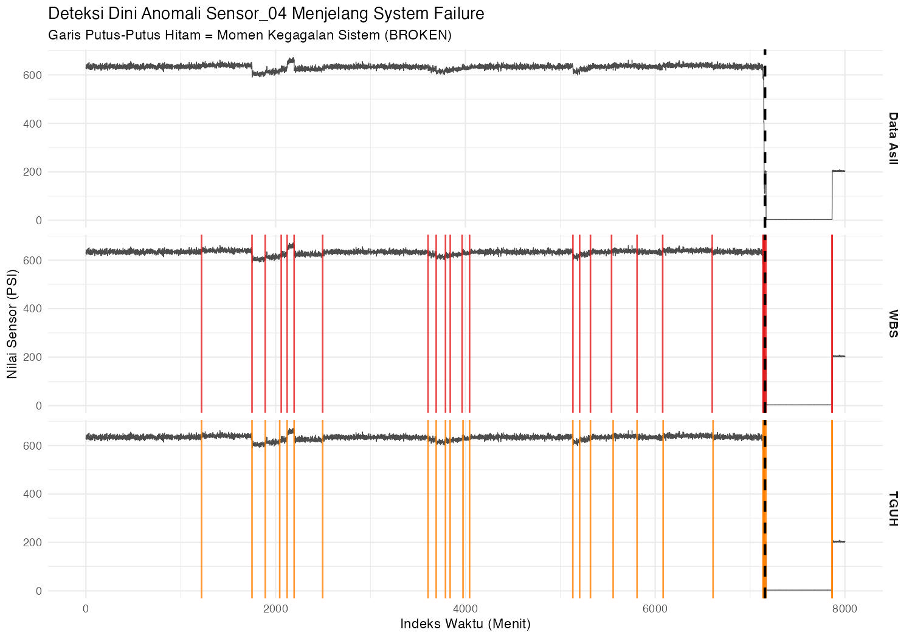

# Deteksi Perubahan pada Data Sensor Pompa Industri (WBS & TGUH)

Proyek kecil untuk mencoba metode *change point detection* yang menjadi fokus tugas akhir saya pada data sensor pompa industri yang akhirnya rusak. Idenya, kalau ada pergeseran pada sinyal sensor sebelum mesin mati, apakah metode seperti *Wild Binary Segmentation* (WBS) dan *Tail Greedy Unbalanced Haar* (TGUH) bisa mendeteksinya dan menghasilkan sebuah log peringatan sederhana untuk teknisi?

## Disclaimer

- Ini merupakan **demonstrasi konsep**, bukan sistem yang terbukti.
- Saya memakai potongan data (baris 10.000 sampai 18.000) yang sudah saya ketahui memuat satu kejadian kerusakan (BROKEN), di baris 17.156.
- `sensor_04` dipilih berdasarkan hasil notebook Kaggle milik orang lain ("pump-sensor-data (TimeSeriesAnalysis)" oleh shawky El-gendy) yang menunjukkan adanya perubahan yang paling jelas. Jadi, pemilihannya dilakukan dengan mengetahui hasilnya. 
[[tautan notebook: https://www.kaggle.com/code/shawkyelgendy/pump-sensor-data-timeseriesanalysis]]
- Ambang batas status (20%) saya tentukan sendiri. Di lapangan, angka ini sebaiknya ditentukan bersama orang yang paham mesinnya.
- Hanya ada satu kejadian kerusakan di potongan data ini, jadi saya tidak bisa menyimpulkan seberapa andal metodenya secara umum.

## Alur Kerja

1. Memuat data sensor pompa dan mengambil sampel data menjelang kerusakan.
2. Mengisi nilai kosong dengan imputasi stokastik lokal (interpolasi linear ditambah derau sesuai simpangan baku lokal), supaya variasi sinyal tidak terlalu rata.
3. Menjalankan **WBS** dan **TGUH** untuk mencari titik pergeseran pada `sensor_04`.
4. Membuat grafik perbandingan (sinyal asli, titik WBS, titik TGUH, dan garis waktu kerusakan).
5. Membuat sebuah file log berisi tiap titik yang dideteksi oleh WBS dan TGUH (dipisah per metode) diklasifikasikan naik atau turun, diberi status `PERINGATAN` atau `KRITIS` menurut besar pergeserannya (rata-rata 60 menit sebelum vs sesudah), lalu dihitung berapa lama sebelum kerusakan.

Kenapa WBS dan TGUH? Keduanya merupakan metode *change point detection* yang paling stabil pada data berderau besar di tugas akhir saya. 

## Hasil

Log dibuat untuk kedua metode (`EWS_Pompa_Industri.log`). Ringkasannya:

| | WBS | TGUH |
|---|---|---|
| Total titik sebelum kerusakan | 26 | 25 |
| Status PERINGATAN (pergeseran 0,6-5,7%) | 21 | 20 |
| Status KRITIS (pergeseran > 20%) | 5 | 5 |

- Kedua metode hampir sama. Kelima titik KRITIS identik (menit 7135, 7144, 7147, 7151, 7156), 11 titik PERINGATAN identik, dan sisanya selisih paling jauh 17 menit. Satu-satunya titik yang hanya ditemukan WBS adalah menit ke-2140.
- Pergeseran terbesar adalah 92,1% di menit ke-7156, tepat sebelum kerusakan di menit ke-7157. Titik KRITIS pertama muncul 22 menit sebelumnya.
- Titik PERINGATAN tersebar sejak sekitar 4 hari sebelum kerusakan, dengan pergeseran kecil (0,6-5,7%).

Batasan yang perlu diingat:
- Pada data ini, titik PERINGATAN tidak makin besar mendekati kerusakan, jadi saya belum bisa membedakan gejala awal dari fluktuasi normal. Angka "LEAD TIME" pada titik PERINGATAN belum bisa dibaca sebagai bukti peringatan dini. Untuk menjawabnya, dibutuhkan data dari lebih banyak kejadian kerusakan.
- Ada 21 peringatan dalam sekitar 4 hari. Kalau dipakai sungguhan, jumlah ini bisa membuat teknisi kebanjiran alarm. Ambang 20% hanya memisahkan perubahan besar.
- Pergeseran dihitung dari rata-rata 60 menit sebelum dan sesudah titik. Untuk titik dekat kerusakan, jendela "sesudah" ikut memuat data setelah mesin mati, yang tidak tersedia pada sistem real-time. Deteksinya sendiri juga dijalankan offline pada seluruh potongan data.

Contoh isi log:

```
[PERINGATAN] Terdeteksi di Menit ke-1219
   >> Jenis     : LONJAKAN (Spike)
   >> Perubahan : 634.80 PSI menjadi 639.76 PSI (Shift: 0.8%)
   >> LEAD TIME : 4 Hari, 2 Jam sebelum estimasi mati total.
------------------------------------------------------
[KRITIS] Terdeteksi di Menit ke-7144
   >> Jenis     : PENURUNAN (Drop)
   >> Perubahan : 628.11 PSI menjadi 81.07 PSI (Shift: 87.1%)
   >> LEAD TIME : 0 Hari, 0 Jam sebelum estimasi mati total.
```



## WBS atau TGUH?

Pada data ini keduanya memberi hasil yang hampir sama (semua titik KRITIS identik, selisih titik PERINGATAN paling jauh 17 menit), jadi saya tidak bisa menyatakan salah satunya lebih baik dari satu kejadian kerusakan saja. Perbandingan yang lebih terkontrol, dengan ground truth dari simulasi, ada di tugas akhir saya: https://github.com/jdsea-ux/Change-Point-Detection.

## Ide pengembangan (belum dikerjakan)

- Menguji algoritma pada lebih dari satu kejadian kerusakan dan lebih dari satu sensor.
- Menentukan ambang batas bersama orang yang paham mesinnya.
- Mengubahnya menjadi deteksi *online* dengan jendela waktu berjalan, bukan analisis sekali jalan.

## Cara menjalankan

1. Pasang **R** dan **RStudio**.
2. Pasang pustakanya:
   `install.packages(c("readr", "dplyr", "ggplot2", "imputeTS", "changepoint", "wbs", "breakfast"))`
3. Unduh `sensor.csv` dari dataset Pump Sensor Data di Kaggle (https://www.kaggle.com/datasets/nphantawee/pump-sensor-data), lalu taruh di folder yang sama dengan skrip.
4. Jalankan `predictive_maintenance_poc.R`. Skrip akan menampilkan grafik 3 panel dan menyimpan log ke `EWS_Pompa_Industri.log`.

## Catatan

- Dataset yang digunakan berasal dari Kaggle dan bukan data dari perusahaan mana pun.
- Dataset tidak menjelaskan satuan sensor secara resmi. Di grafik saya menulis "PSI" sebagai asumsi, jadi perlakukan itu sebagai perkiraan.
